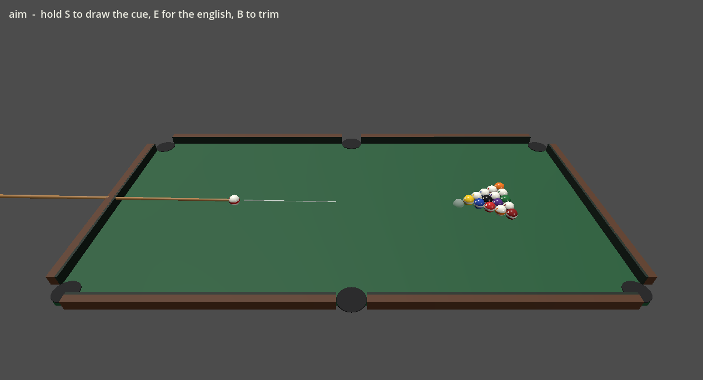

# Virtual Pool — a deterministic 8-ball pool physics engine

A Rust implementation of the physics model specified in
[`docs/virtual-pool-physics.md`](docs/virtual-pool-physics.md) (version 1.7).

The engine is **event-driven and closed-form**: between two events every ball's
state is given by an analytic expression, so nothing is ever integrated step by
step. The same shot produces the same bytes on every run and on every platform.

```rust
use pool_core::{simulate_shot, BallState, ShotInput, TableConfig};
use pool_core::math::Vec3;

let cfg = TableConfig::default();
let mut balls = Vec::new();
balls.push(BallState::at_rest(&cfg, 0, Vec3::new(0.635, 0.635, cfg.ball.radius)));
balls.push(BallState::at_rest(&cfg, 1, Vec3::new(0.9, 0.635, cfg.ball.radius)));
let state = simulate_shot(ShotInput::new(1.5, Vec3::X, balls), &cfg);
println!("the object ball ended at x = {}", state.balls[1].position.x);
```

## Layout

| Path | What it is |
|---|---|
| `pool-core/` | the library: the physics core, the table configuration and the state model |
| `pool-cli/` | the headless tuning harness: it fires parameterised shots and writes CSV |
| `pool-visual/` | the visual simulation: it turns a shot into a page you can watch |
| `pool-godot/` | the Godot 4 binding: a GDExtension that hands the core to the game |
| `godot-project/` | the Godot project: the game around the extension |
| `demos/` | the gallery: one page per scene, and the index that links them |
| `docs/virtual-pool-physics.md` | the research document the model follows |
| `tests/fixtures/` | the validation fixtures: the acceptance criteria of the core |

Inside `pool-core/src`:

| Module | What it holds |
|---|---|
| `math.rs` | `Vec2`/`Vec3` and the safe helpers (no `NaN` by construction) |
| `config.rs` | `TableConfig`: every tunable parameter, and the JSON round trip |
| `geometry.rs` | the table geometry derived from the configuration (rails, pockets) |
| `state.rs` | `BallState`, `GameState`, `ShotInput`, `MotionState`, `GamePhase` |
| `cloth.rs` | the closed-form ball-cloth motion of §3 (slide, roll, spin) |
| `ball_ball.rs` | the ball-ball impulse of §4.4.5 and its time of impact |
| `cushion.rs` | the Han cushion model of §5.1 and the three rail regimes of §11.3 |
| `pocket.rs` | the pocket state machine, the facings and the shelf of §9 |
| `cue.rs` | the cue strike, the squirt curve and the miscue limit of §6 |
| `quartic.rs` | the deterministic root finder used by the time-of-impact solvers |
| `sim.rs` | the event loop: the heart of the engine |
| `trace.rs` | the path of a shot: the segments a renderer interpolates (§11.2) |
| `hash.rs` | the canonical byte form of the state and its hash, for the determinism check |
| `json.rs` | a small, exactly-rounding JSON reader and writer |

The canonical byte form of a state (`pool_core::canonical_bytes`) is what the
determinism check compares: the raw `f64` values in a fixed order, never a
formatted or rounded representation. `pool_core::hash_state` is the FNV-1a hash of
those bytes, and it is the value the `determinism_golden` fixture pins.

## Building and testing

```sh
cargo build
cargo test              # the unit tests, the fixtures, the determinism and the edge cases
cargo test --release    # the same suite, faster
cargo clippy --all-targets
```

The fixtures are the acceptance criteria. They live in `tests/fixtures/`, they are
read by `pool-core/tests/fixtures.rs`, and they are generated by
`tests/fixtures/generate_fixtures.py` from the same equations as the document.

## The guarantees

* **Event driven.** The loop finds the earliest event, advances every ball
  analytically to that time and applies the event. There is no integration
  anywhere in the physics path.
* **Deterministic.** `f64` everywhere, the `libm` crate instead of the platform's
  libm, a total order on the events (`time`, event kind, ball index, ball index),
  no hash map iteration, and no floating point flags that differ between targets.
  `pool-core/tests/determinism.rs` pins the hash of a full break shot and compares
  the canonical byte form of two runs.
* **No panics.** The physics path contains no `unwrap`, no `expect` and no
  `panic!`; degenerate cases are handled explicitly and the entry point reports a
  fault through the phase of the returned state.
* **No magic numbers.** Every tunable parameter lives in `TableConfig`. The
  cushion's contact height `eps` is *derived* from the specified nose height, not
  stored.
* **A complete state.** `GameState` carries the balls, the phase (a shot that ran
  into the time limit is `Settling`, not `Settled`), the foul and miscue flags, the
  elapsed time and the cue stick as the renderer wants it.

## The versions

Two versions move, and they mean different things:

| | What it is |
|---|---|
| `pool_core::MODEL_VERSION` | the version of the **physics model** - the same number as the research document's version (`1.7`) |
| the crate version (`0.1.0`) | the version of the **API** |

A change to the model bumps both; a change to the API only bumps the crate
version. The model version is what the game asks for -
`PoolCore.get_model_version()` - so a game can tell which model it is talking
to, and a recorded shot can be tied to the model that produced it.

The game shows it in the corner, because the extension is a library that is
loaded when the game starts: **a game that is left running keeps the physics
it was started with**, however new the library on disk is. After a change to
the core, rebuild the extension (`godot-project/build-extension.sh`) *and
restart the game*.

The crates are released in order: `pool-core` first, because `pool-godot`
depends on it. The version of `pool-core` in `pool-godot/Cargo.toml` is the
one that goes to crates.io, and the two are bumped together.

## The tuning harness

The parameters that the document marks as "to be fitted" are meant to be fitted
against data, not by feel. `pool-cli` fires parameterised shots and writes CSV:

```sh
pool-cli simulate --cue-speed 2 --aim-deg 0 --object 0.9,0.635
pool-cli sweep --kind speed   --from 0.5 --to 6   --steps 12   # the separation and the throw
pool-cli sweep --kind cut     --from 0   --to 60  --steps 13   # the throw against the cut angle
pool-cli sweep --kind english --from 0   --to 0.5 --steps 6    # the squirt curve
pool-cli sweep --kind cushion --from 0   --to 90  --steps 19   # the rebound against the incidence angle
pool-cli sweep --kind hop     --from 1   --to 5   --steps 9    # the hop that a cushion drives into the slate
```

The calibration order is the one of §13.3: `mu_s` and `mu_r`, then `mu_sp`, then
the nose height, then `e_cushion`, then the pocket parameters, then the squirt
curve, then the ball-ball constants.

## Seeing the physics

The core never integrates anything, so the path of a shot is a *list of segments*:
between two events every ball is on a parabola. `pool-core/src/trace.rs` is that
list, and `pool-visual` puts it on the screen.

```sh
pool-visual list                          # the demo scenes
pool-visual shot --scene break            # writes break.html
pool-visual shot --scene trio             # the draw, the stun and the follow
pool-visual trace --scene cut             # the same shot, as raw JSON
pool-visual demos                         # the whole gallery, into demos/
pool-visual shot --scene custom --cue 0.6,0.635 --object 1.4,0.635 --cue-speed 3
```

The page is a single file: no server, no network, no build step. It opens from
the disk in any browser. The table on it is drawn from the core's own
`TableGeometry`, so the picture and the model cannot drift apart, and the balls
are placed by evaluating the same closed-form segments the core does - the
trails are the model's trajectory, not a resampling of it.

The page has the shot on a timeline, the events as colour-coded ticks, the event
log with a click on every entry to jump to it, the trails of the balls, and a dial
for the cue ball's spin. Space plays and pauses, the arrow keys step from event
to event.

The gallery in [`demos/`](demos/) holds one page per scene and an index that
links them; `pool-visual demos` regenerates the lot.

The demo scenes:

| Scene | What it shows |
|---|---|
| `break` | a full rack, the cue ball into the head ball: the burst and the drops |
| `trio` | one shot at three spins - the cue ball goes three different ways |
| `cut` | three cut angles: the throw of the object ball off the line of centres |
| `english` | three amounts of side spin: the launch line is not the aim line |
| `cushion` | four incidence angles into the same rail |
| `jump` | an elevated cue: the ball hops off the slate |

## The game

`pool-godot/` is a [GDExtension](https://godotengine.org): the core, handed to
Godot 4 as a library. `godot-project/` is the game around it.

The rule that shapes the whole thing: **the core is the only physics.** Godot
never simulates the balls, so there is one source of truth and the determinism
the core promises reaches the game. A shot is therefore not a stream of frames
but a *path*: the core resolves the whole shot in one call - it is event
driven, so a shot is a handful of events and takes no time at all - and the
game plays the path back, sampling the same closed-form segments the
simulation used.

```sh
./godot-project/build-extension.sh    # build the extension, copy it into the project
godot --headless --path godot-project # the smoke test
```

The extension gives the game two classes:

| Class | What it is |
|---|---|
| `PoolCore` | the table, the aim preview and the shot |
| `PoolShot` | a resolved shot: the path to play back and the state it ends in |

`PoolCore.preview_cue_strike` and `PoolCore.simulate` call the *same* strike in
the core, so the line the game draws at the player is the line the ball takes,
squirt included. The frame is converted in exactly one place,
`pool-godot/src/frame.rs`, and the tests in `pool-godot/tests/mapping.rs` pin
the english with the physics: a tip dragged to the shooter's right has to
throw the object ball to the shooter's left.

`pool-godot/tests/headless.rs` and `godot-project/scripts/smoke_test.gd`
describe the same shot and pin the same hash, so a number that moves on the way
from Godot to the core stops both sides from agreeing.

The game has a table built from the core's own geometry, sixteen balls on it
and the controls a pool game has always had: the mouse aims, **S** draws the
cue back and a flick lets it go, **E** holds the english and **B** holds the
fine aim.



Three tests run it, all headless and all with an exit code:

```sh
godot --headless --path godot-project scenes/smoke_test.tscn   # the data survives the trip
godot --headless --path godot-project scenes/play_test.tscn    # a break, and the balls scatter
godot --headless --path godot-project scenes/input_test.tscn   # the mouse and the keys do what they say
```

What is not there yet: the rules. The shot resolves and the balls come to
rest, but nothing decides who won.

## What the model does and does not do

The document lists its own limitations, and they are reproduced faithfully here:

* **The throw follows the measured speed dependence, and the rest is a recorded
  deviation.** The friction between the balls falls with the sliding speed
  (§4.4.5, TP A.14: `mu(v) = 0.009951 + 0.108 e^(−0.77 v)`, normalised at a 1 m/s
  slip onto `mu_ball`), so the throw is larger on slow shots, as the measurement
  says. In the sticking regime it matches the published formula
  `atan(2 tan(cut) / (7 (1 + e)))`. What is knowingly wrong is the rest: the three
  measured columns at a 30 degree cut cannot be fitted by *any* law of the form
  `A + B e^(−K u)`, for any floor term and any decay constant, so the residual
  (up to about a degree) is left as a deviation and no calibration is layered on
  top of it. The `cut_throw_sweep` fixture pins it at 1.05 degrees (§14.1, §14.3).
* **The vertical spin decay is linear, and stops at zero.** §3.2 writes
  `w_z(t) = w0 - (5 mu_sp g / 2R) t`, and a linear decay has to be told where
  zero is: it acts towards zero and stops there. Without that, a ball whose
  spin reached zero would go on past it into a backspin, and a backspin would
  grow instead of dying - and the ball would never come to rest, because the
  state it reaches depends on a spin that never ends.
* **The squirt comes from the sideways offset, and the curve behind it is
  uncalibrated.** The core looks the squirt curve up at the *sideways* part of the
  contact only (§6.1): the tip slides around the ball, so only a sideways offset
  makes it slide sideways, and a draw or a follow - a vertical offset - goes
  straight down the aim line. The spin and the miscue limit keep using the whole
  impact parameter, because a tip above the centre does give topspin and does slip
  off at the same offset. What is not known is the curve itself: the anchors are
  still `null` and marked `TO BE CALIBRATED` (Cross 2008 has not been transcribed),
  so the squirt is the shape of the curve and not a measurement (§14.5). The
  `english` scene shows the squirt as the model has it.
* **The hop over-predicts at break speed.** The rigid cushion model scales the hop
  with `v^2`. `TableConfig::slate.max_cushion_rebound` is the compliant-contact
  correction the document asks for: it leaves the behaviour the fixture pins (a
  2 m/s cushion hit hops 3.8 mm) and stops a break-speed hit from launching the
  ball off the table.
* **The ball-ball model is planar.** The document's collision model is a planar
  one; the vertical effect of a collision is the table effect of §4.5 (the lift),
  not a vertical component of the contact impulse. The contact test is planar for
  the same reason.
* **Magnus and air drag are omitted.** Both are negligible for pool ball sizes and
  speeds (§7.1, §13.4).
* **Multi-ball collisions are resolved pairwise**, in the order
  `(time, event kind, ball index)` (§4.6, §11.4).

Two further notes on the fixtures:

* `cushion_rebound.json` contains an invariant that says the speed loss is largest
  around a 40 degree incidence. The model's own numbers in the same file show that
  the loss is largest at the square hit and decreases with the incidence angle;
  the invariant is a statement about Mathavan's measurements, which the rigid
  model does not reproduce. The test checks the numbers.
* The `determinism_golden.json` layout was moved onto the table: the generator
  placed the rack at `y = 1.270`, which is the far rail of a 1.27 m wide table, so
  the balls were off the table and the shot was not a break. The foot spot is
  `(0.635, 0.635)`.

## References

The physics comes from the document's bibliography: Han (2005) for the cushion,
Mathavan et al. (2010) and Alciatore (2007) for the measurements, Kim (2021,
2024) for the cue and the collision models, Cross (2008) for the squirt, and
Kiefl (2020) for the analytical ball-cloth equations. The full list is in the
document.
