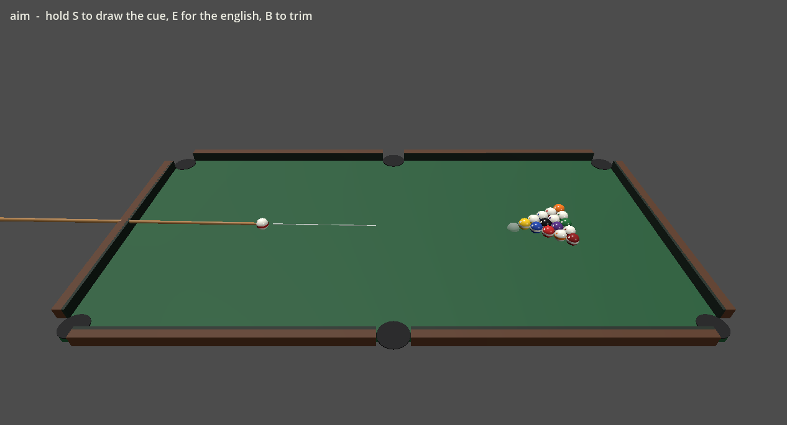
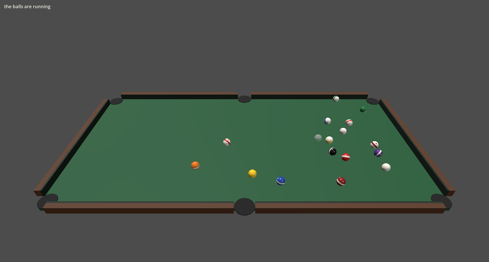

# The Godot project

The game. The physics is not here: it is in the Rust extension in
[`../pool-godot`](../pool-godot), and this project is the game around it.



## How it fits together

The core is the **only** physics in the game. Godot never simulates the balls:
the core resolves a shot in one call and hands back the path of every ball,
and the game plays that path back.

```
the player aims                →  PoolCore.preview_cue_strike(...)
the player shoots              →  PoolCore.simulate_with_rotations(...)  →  a PoolShot
every frame                    →  PoolShot.sample(t)            →  the positions
                                 PoolShot.sample_rotation(t)    →  the turns
the shot ends                  →  PoolShot.get_final_state()    →  the rules
```

`preview_cue_strike` and `simulate` call the *same* strike in the core, so the
line the game draws is the line the ball takes, squirt included.

The game shoots with `simulate_with_rotations`, which takes one more list: the
orientation every ball carries into the shot. `PoolShot.sample_rotation(t)`
reports the turn up to `t` counted from that orientation, so the game hands the
last frame of the path back to the next shot and a ball keeps the phase the last
shot left it in. GDScript never adds up a turn — `ball.gd` puts the orientation
on the mesh — and `PoolCore.simulate` is the same shot with every ball left
straight, which is what a fresh rack is.

The table is built from `PoolCore.get_table_geometry()` — the rails, the
pockets and the cushion all come from the model, so the cushion stops exactly
where the model says the pocket begins.



## The controls

| | |
|---|---|
| the mouse | aims |
| **S** | draws the cue back; push the mouse home, and the speed of the push is the power |
| **B** | holds the cue: the mouse then raises it above the cloth. A drag down the screen lifts the butt, a drag up lays the cue back flat, and the raise tops out at 60 degrees |
| **E** | holds the english: the mouse then moves the tip on the cue ball |
| **F** | holds the fine trim: the mouse then trims the angle slower, and moves the tip finer while **E** is held |
| **D** | raises the debug panel: the numbers of the shot, on the screen |

While **E** is held the mouse stops aiming and only moves the tip, so the tip
wins over the raise: a player holding **E** and **B** together is looking at the
point of the cue they are placing, and the cue keeps the height they left it at.
The rest of the time the mouse turns the shot with its sideways part and raises
the cue with its up and down part, so one drag can turn and raise at once - and
once **S** has the cue on its backswing the up and down belongs to the draw, so
the height stays where the player left it and no gesture sets the power and the
angle at the same time.

Raising the cue is what makes a stroke a jump shot: a steep, firm stroke with
the tip below the centre drives the cue ball into the slate beside the object
ball rather than along the bed, and §7.1's jump is that slate launching it. The
raised cue is drawn, aimed and fired as a raised cue - the height is baked into
the direction the core is given - and past 5 degrees the ghost ball stops being
drawn, because the hop a raised cue puts in the line to the object ball meets
that ball in the air, where a ghost on the cloth cannot promise it. The panel
says the ghost was refused rather than leaving it out.

The power of the shot is the speed the cue is running at when it meets the
ball, up to 9 m/s: a full draw brought home slowly is a stun, and a full draw
flicked home hard is a break. How far the cue went back only says how far it
had to run over to get there: the bar and the read-out show the speed while
the stroke runs.

Once the stroke is taken, the mouse stops aiming: the flick that fires the
shot may land anywhere, and its sideways wobble does not turn the shot on
the way out. The aim and the tip are the player's last look, and the shot
that goes is the one the panel showed them.

The english is the one sign that is easy to get wrong. The core measures the
contact offset along `up x direction`, which is the shooter's **left**, so a
tip dragged to the shooter's right is a **negative** offset, and right english
throws the object ball to the shooter's left. The tests in
`../pool-godot/tests/mapping.rs` pin that with the physics.

## The debug panel and the log

**D** raises the debug panel: while the player aims it names the line of the
cue, the height of the cue in degrees, the line the ball really leaves on (the
squirt included), the tip in millimetres and the ghost in metres - or says that
the ghost was refused because the cue is raised past where the cloth can hold
the promise; while the shot runs it names the speed and direction of the cue
ball, the spin it carries in radians a second and the events resolved so far.

The whole report of every shot is printed to the log whether the panel is up
or not, so the numbers behind a shot can be handed over when a picture
cannot show them:

```sh
godot --path godot-project 2>&1 | tee /tmp/pool.log
```

The panel and the log quote the core's numbers rather than the picture's,
and the core is the only physics: what the panel says, a test can check.

The height of the cue is one of them. `preview_cue_strike` returns
`elevation_deg`, the asin of the height of the direction it was given - the same
reading `../pool-core/src/sim.rs` takes of the cue stick at 1209 - so the game
prints the angle the core got the shot from, not the angle it asked for. A
raise that never reached the stroke would leave the readout saying a level cue
while the picture drew a raised one, and `pool-godot/tests/headless.rs` keeps a
pin for exactly that.

## Building

The extension has to be built before the project will open:

```sh
./godot-project/build-extension.sh        # the release build
./godot-project/build-extension.sh debug  # the debug build
```

It builds `pool-godot` with cargo and copies the library into `bin/`, where
`bin/pool_godot.gdextension` points at it. The build needs no Godot binary:
the bindings come from the prebuilt API of the `godot` crate.

The library itself is not in the repository (`bin/*.so` is ignored), so a change
to the extension source reaches the game only once this script has been run
again. The `.gdextension` file names the libraries and the entry symbol and
nothing else: the methods are registered by the library when it loads, so a new
`#[func]` needs a rebuilt library and no edit to that file.

## Running

With Godot 4.6 or later:

```sh
godot --path godot-project
```

The tests, all headless and all with an exit code:

```sh
godot --headless --path godot-project scenes/smoke_test.tscn   # the data survives the trip
godot --headless --path godot-project scenes/play_test.tscn    # a break, and the balls move
godot --headless --path godot-project scenes/input_test.tscn   # the mouse and the keys do what they say
```

And a picture, if you want one:

```sh
godot --path godot-project -- --screenshot /tmp/table.png
```

## The frame

The core works in a right handed frame with `x` along the table, `y` across
it and `z` up. Godot has `y` up, so the extension converts once, in
`../pool-godot/src/frame.rs`:

```
core (x, y, z)  ->  Godot (x, z, -y)
```

One of the two in-plane axes has to change sign for the frame to stay right
handed, and that keeps the sense of the spin — so a ball that rolls to the
left rolls to the left on the screen. The turn of a ball goes through the same
map, and a proper rotation of a proper frame is a proper rotation: what
`PoolShot.sample_rotation(t)` reports is the same turn on the screen. A turn is
an orientation, not a step to be added up; the path of the shot is the only
thing that says how a ball turned.

## What is not here yet

The rules. The shot resolves and the balls come to rest, but nothing decides
who won: no 8-ball rules, no fouls beyond the ones the core reports, no
ball-in-hand and no opponent. The next milestone.
